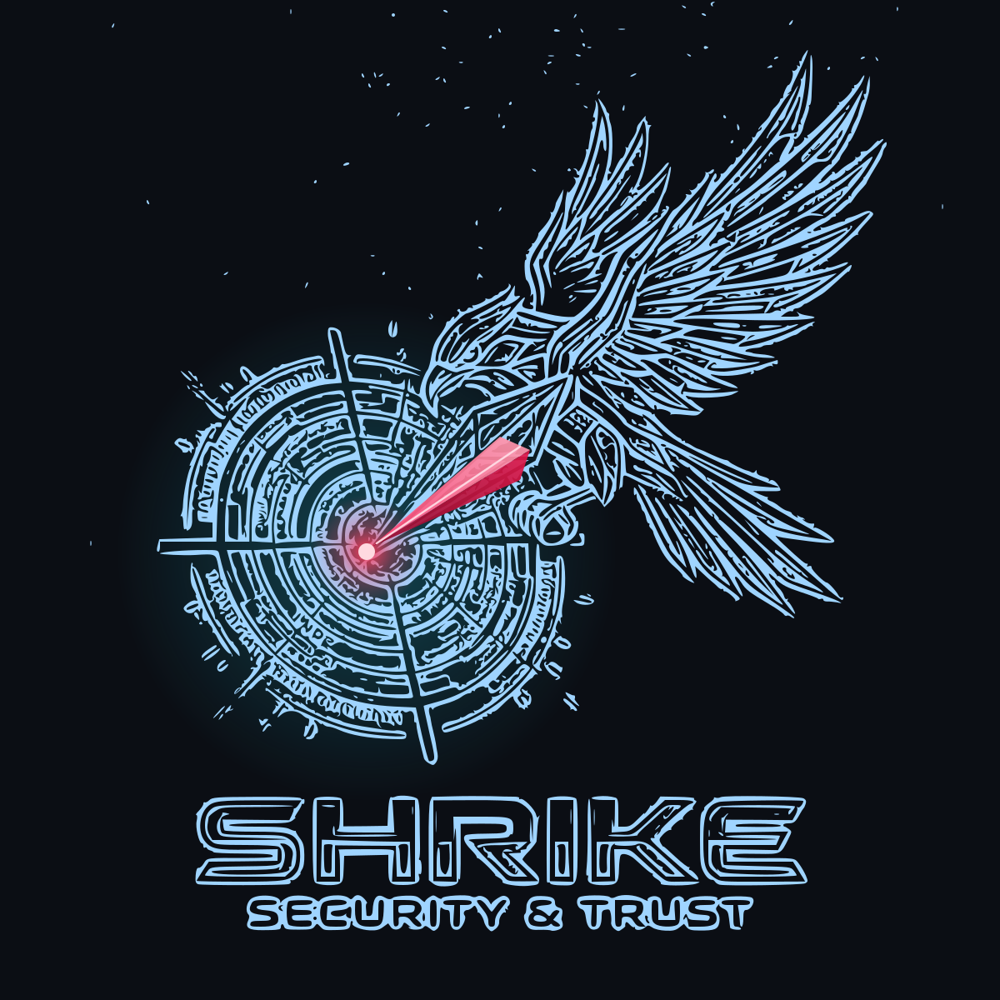
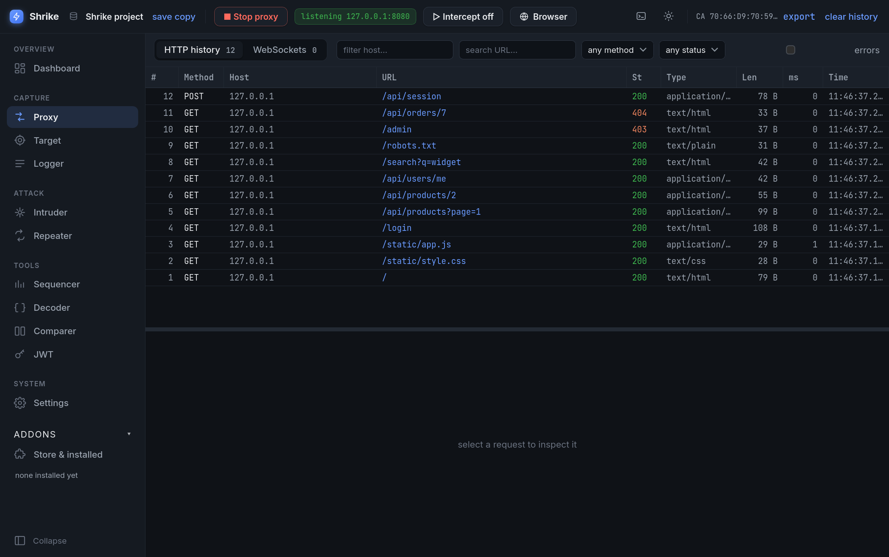
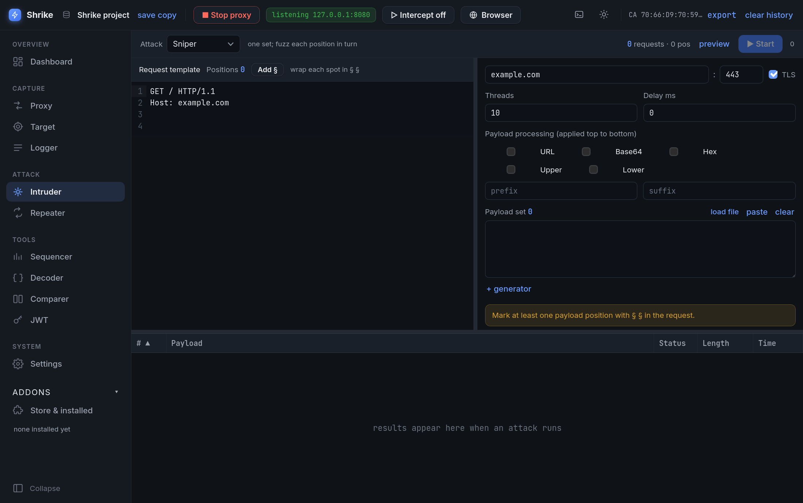
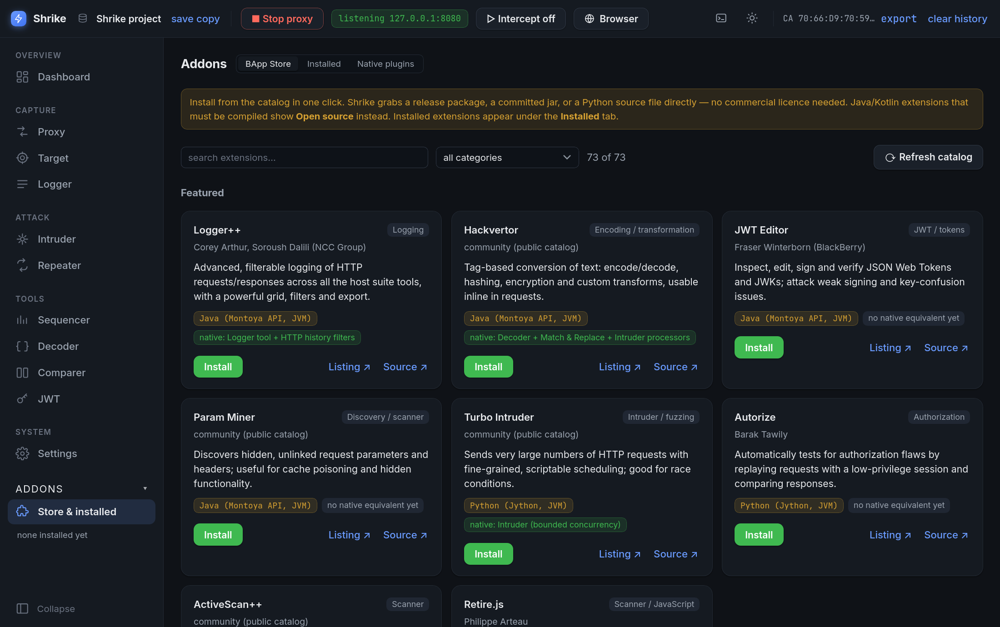
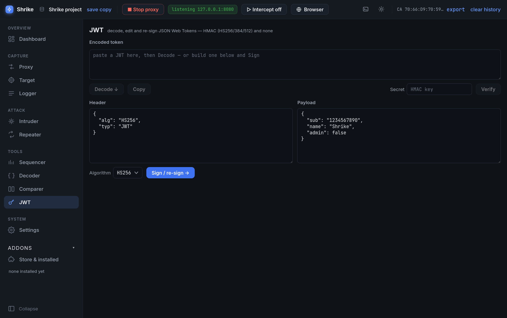
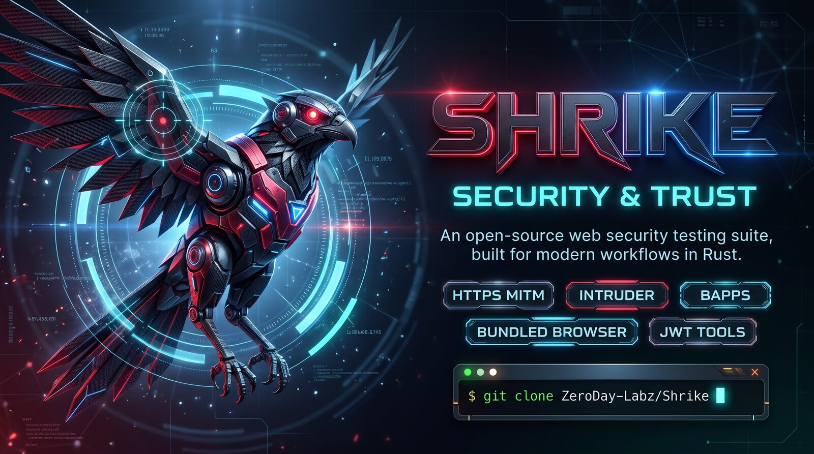

<p align="center">
  
</p>

<h1 align="center">Shrike</h1>

<p align="center">
  <b>Open source web application security testing platform, written in Rust.</b><br>
  A fast, full featured Burp Suite alternative for penetration testing and bug bounty:
  an intercepting HTTPS proxy, a web vulnerability scanner, a fuzzer, an out-of-band (OAST)
  interaction server, content discovery, templated detections, and an extension system that
  runs existing Java and Python addons. One desktop app, no subscription, no telemetry.
</p>

<p align="center">
  <a href="https://github.com/ZeroDay-Labz/Shrike/releases/latest"></a>
  <a href="https://github.com/ZeroDay-Labz/Shrike/actions/workflows/ci.yml"></a>
  <a href="https://github.com/ZeroDay-Labz/Shrike/releases"></a>
  <a href="LICENSE"></a>
</p>

<p align="center">
  
</p>

## What is Shrike

Shrike is a professional grade web application security testing suite that runs as a single
cross platform desktop app on Windows, Linux and (from source) macOS. It gives penetration
testers, red teamers and bug bounty hunters the full workflow in one place: capture and modify
HTTPS traffic through a man-in-the-middle proxy, replay and fuzz requests, scan for web
vulnerabilities, discover hidden content, confirm blind bugs with an out-of-band interaction
server, and track findings into a shareable report.

It is a genuine open source alternative to Burp Suite and other commercial DAST and web pentest
tools. Everything is MIT licensed, there is no paid tier, and every automated action is also
drivable by hand so you keep full control.

Shrike is clean-room. Nothing in it is derived from any proprietary tool's source or binary. It
is modelled only on published extension APIs (the Montoya and legacy Extender interfaces), public
documentation, observable behaviour and open source analogues. See
[docs/architecture.md](docs/architecture.md) and [docs/feature-gap.md](docs/feature-gap.md).

## What's new in 0.9.0

* **Out-of-band (OAST) interaction server.** A self-hosted DNS and HTTP listener for confirming
  blind vulnerabilities: blind SSRF, blind XSS, blind SQL injection and out-of-band RCE. Every
  probe mints a unique `token.your-domain` payload, and the DNS or HTTP callback is correlated
  back to it and streamed live in the new **Interactions** tab. It is self-hosted on purpose, so
  your callbacks never route through a third party.
* **Content discovery.** A fast path and file brute-forcer (an ffuf / dirsearch style engine)
  with a built-in wordlist plus your own words and extensions. It learns the "not found"
  fingerprint from random probes first, so soft-404s and catch-all pages do not bury the real
  hits. Results stream into the new **Discovery** tab.
* **Templated scanner.** Data-driven detections you add as JSON, no Rust required. Templates
  describe requests and word / regex / status matchers with and/or conditions plus extractors,
  with `{{BaseURL}}` style interpolation. Built-in templates ship for exposed `.git/config`,
  `.env`, `phpinfo()` and Spring Boot Actuator, and you can drop your own in the templates folder.
  The new **Templates** tab runs them and files matches as Findings.
* **Extension compatibility.** A legacy `IBurpExtender` load path, a context-menu bridge so
  extensions contribute right-click actions, and a scanner hook so an extension's passive scan
  issues become Shrike Findings. Plus a native race-condition (single-packet / last-byte-sync)
  attack mode in Intruder.

## Features

* **Intercepting HTTPS proxy.** A real man-in-the-middle proxy with its own CA, per-host leaf
  certificates, HTTP/1.1, HTTP/2 and WebSockets. Scope rules are enforced in the Rust core for the
  proxy and for automated tools, with match and replace, and an Intercept queue with forward, drop
  and forward-all. Response capture is streaming and memory bounded.
* **Web vulnerability scanner.** A passive scanner raises Findings from captured traffic (missing
  security headers, cookie flags, reflected input, information leaks, mixed content, vulnerable
  JavaScript libraries, JWT issues) and sends no extra requests. An active scanner probes insertion
  points for reflected XSS, SQL injection, SSTI, path traversal, command injection and open
  redirect, strictly scope-gated, bounded and abortable.
* **Out-of-band interaction server (OAST).** Self-hosted DNS and HTTP listeners that confirm blind
  and out-of-band vulnerabilities and correlate every callback to the payload that caused it.
* **Content discovery.** Brute-force unlinked paths and files (admin panels, backups, API routes,
  config files) with baseline and soft-404 filtering.
* **Templated detections.** A matcher and extractor engine driven by JSON templates, so you and
  the community can add checks without writing code.
* **Hidden parameter discovery.** Brute-force likely parameter names and flag the ones the server
  actually reacts to (reflection or status change), a native param-miner equivalent.
* **Crawler.** A scope-gated spider that maps a host into the site map and feeds the scanner.
* **Repeater.** Tabbed manual request editing with a scrollable editor and response viewer.
* **Intruder.** Sniper, Battering ram, Pitchfork and Cluster bomb with `§` payload positions,
  payload generators and processors, a native race-condition attack mode, a bounded concurrent
  engine that runs hundreds of requests without locking the UI, and a virtualised results grid.
* **Integrated browser.** Chromium (Chrome for Testing) bundled into every installer, launched
  pre-configured for the proxy and already trusting Shrike's CA. It works offline with no system
  browser, no proxy switcher extension and no manual certificate import.
* **Findings and reporting.** Record security issues with severity, confidence, status and linked
  requests, highlight and annotate history rows, and export a self-contained HTML or JSON report.
* **Decoder, Comparer, Sequencer, JWT, Logger, Dashboard.** The everyday toolkit, all native. The
  JWT tool decodes, edits and re-signs tokens (HS256/384/512 and `none`) in-app with no JVM.
* **Query language.** Filter history with the Shrike Query Language, for example
  `host:example.com code>=400 method:POST`, compiled to safe parameterised SQL.
* **Extensions (BApp compatible).** A built-in store mirrors the full public extension catalog from
  GitHub and installs with one click from a release package, a committed jar, or straight from
  source. Extensions run in Shrike's own JVM host: Java through the published Montoya API, Python
  through Jython and the legacy Extender API, with a live console per addon. A native Rust plugin
  API is available too.
* **Projects.** Everything persists in an on-disk SQLite project with backup and save-a-copy, and
  XML item exports from other proxy tools import straight into history.

## Download

Prebuilt packages are on the [Releases](https://github.com/ZeroDay-Labz/Shrike/releases) page:

| Platform | File | Install |
| --- | --- | --- |
| Windows 10/11 (x64) | `Shrike_<version>_x64-setup.exe` | Run it. SmartScreen may warn because the installer is not code-signed; choose *More info ▸ Run anyway*. |
| Debian / Ubuntu | `Shrike_<version>_amd64.deb` | `sudo apt install ./Shrike_<version>_amd64.deb` |
| Fedora / RHEL / openSUSE | `Shrike-<version>-1.x86_64.rpm` | `sudo dnf install ./Shrike-<version>-1.x86_64.rpm` |
| Any Linux (AppImage) | `Shrike_<version>_amd64.AppImage` | `chmod +x` it and run. |
| Any Linux (portable) | `shrike-<version>-linux-x86_64.tar.gz` | Extract and run `./shrike-gui` (the headless proxy is `./shrike`). |
| Any Linux (Flatpak) | `shrike.flatpak` | `flatpak install --user shrike.flatpak` (needs the Flathub remote for the runtime) |

Java addons need a JRE: Shrike uses a bundled one when the package ships it, otherwise any `java`
on your `PATH`. The **Addons ▸ Store & installed** tab sets up the host and Jython with one click.

## Quick start

1. Install and launch Shrike, then start the proxy (it listens on `127.0.0.1:8080` by default).
2. Open the integrated browser from the toolbar. It already trusts Shrike's CA, so HTTPS just works.
3. Browse the target. Requests appear in Proxy history and the site map.
4. Add the target host to the engagement scope (the Target tab), then run the passive and active
   scanner, content discovery or the templated scanner against it.
5. To confirm blind bugs, open **Interactions**, start the OAST server, generate a payload and
   inject it where a target might call back.
6. Track issues in **Findings** and export an HTML or JSON report.

Only test systems you are authorised to test.

## Build from source

The project is a Cargo workspace: `engine/` (library), `cli/` (headless proxy `shrike`),
`src-tauri/` (desktop app) and `ui/` (React + TypeScript frontend). You need Rust (stable),
Node 22, and on Linux the WebKitGTK dev packages (`libwebkit2gtk-4.1-dev librsvg2-dev
libappindicator3-dev patchelf`).

```sh
npm --prefix ui install      # first time only
npm run dev                  # launch the desktop app with hot reload
npm run build                # build installers (.rpm / AppImage / .exe) for this platform
scripts/package-tarball.sh   # portable Linux tarball after a release build
```

`cargo run` does not launch the GUI (Tauri wires the frontend through its own CLI); use
`npm run dev`. The headless proxy needs nothing extra:

```sh
cargo cli                    # or: cargo run -p shrike, listens on 127.0.0.1:8080
cargo cli -- ca trust        # import the CA into local Firefox/Chrome profiles
cargo cli -- -l 0.0.0.0:8080 -k
```

Optional bundles for a self-contained package: `scripts/fetch-jvm.sh` (JVM host jars plus a jlink
runtime) and `scripts/fetch-chromium.sh` (Chrome for Testing). Tests: `cargo test --workspace`.

## Trusting the CA (external browsers)

The integrated browser already trusts Shrike's CA. For any other client, export it
(`cargo cli -- ca export ~/shrike-ca.crt`, or browse to `http://shrike/cert` through the proxy) and
import it as a root; compare the SHA-256 fingerprint from `ca info` on import.

| Client | Steps |
| --- | --- |
| Firefox | Open `http://shrike/cert` through the proxy and tick *Trust this CA to identify websites*, or `ca trust` then restart. |
| Chrome / Chromium | `certutil -d sql:$HOME/.pki/nssdb -A -t "C,," -n shrike -i shrike-ca.crt` |
| Fedora system store | `sudo cp shrike-ca.crt /etc/pki/ca-trust/source/anchors/ && sudo update-ca-trust` |
| Debian / Ubuntu | `sudo cp shrike-ca.crt /usr/local/share/ca-certificates/shrike.crt && sudo update-ca-certificates` |
| Windows | `certutil -addstore -f Root shrike-ca.crt` |
| curl | `curl --proxy http://127.0.0.1:8080 --cacert shrike-ca.crt https://example.com/` |

## Roadmap

Shrike is built toward full professional parity, one feature at a time. Shipped so far: the
intercepting proxy, Repeater, Intruder with a native race-condition mode, the passive and active
scanners, the crawler, content discovery, the templated scanner, the out-of-band (OAST)
interaction server, hidden parameter discovery, the findings and reporting layer, and the
extension bridges (Montoya, legacy Extender, context menu and scanner hook).

Next up:

4. **More active-scan vulnerability classes.** Reflected, stored and DOM based XSS, boolean and
   time-based blind SQL injection, SSRF, SSTI, OS command injection, path traversal, open redirect,
   CORS misconfiguration, XXE and host header injection, with the blind variants wired to the OAST
   interaction server.
5. **Authentication, APIs and more tooling.** Session and token handling with login macros and
   automatic re-authentication, authorization testing, GraphQL tooling, a WebSocket Repeater,
   interactive JWT attacks, and a richer target site map.
6. **Recon and reporting.** JavaScript endpoint and secret extraction, subdomain enumeration, scope
   import from program pages, report export for bug bounty submissions, and request rate limiting to
   respect program rules.

Status and gaps are tracked in [docs/feature-gap.md](docs/feature-gap.md).

## Screenshots

| Proxy history | Intruder attack |
| --- | --- |
|  |  |

| Addons side panel | JWT tool |
| --- | --- |
|  |  |

Screenshots are taken against local lab targets only, with no real hosts, cookies or tokens.

## Concept art

<p align="center">
  
</p>

## License and trademarks

Shrike is developed by [ZeroDay-Labz](https://github.com/ZeroDay-Labz) and licensed under the MIT
license. See [LICENSE](LICENSE). Use it only against systems you are authorised to test.

Burp Suite and PortSwigger are trademarks of their respective owners. Shrike is an independent,
clean-room project and is not affiliated with, endorsed by or derived from them. Product names are
used only for accurate comparison and compatibility description.

<sub>
Keywords: web application security testing, web app pentest tool, open source Burp Suite
alternative, web vulnerability scanner, intercepting HTTPS proxy, HTTP interceptor, man-in-the-middle
proxy, bug bounty toolkit, penetration testing software, DAST, OWASP testing, web fuzzer, Intruder,
Repeater, out-of-band OAST interaction server, content discovery, directory brute force, hidden
parameter discovery, templated vulnerability scanner, JWT editor, Rust security tool.
</sub>
