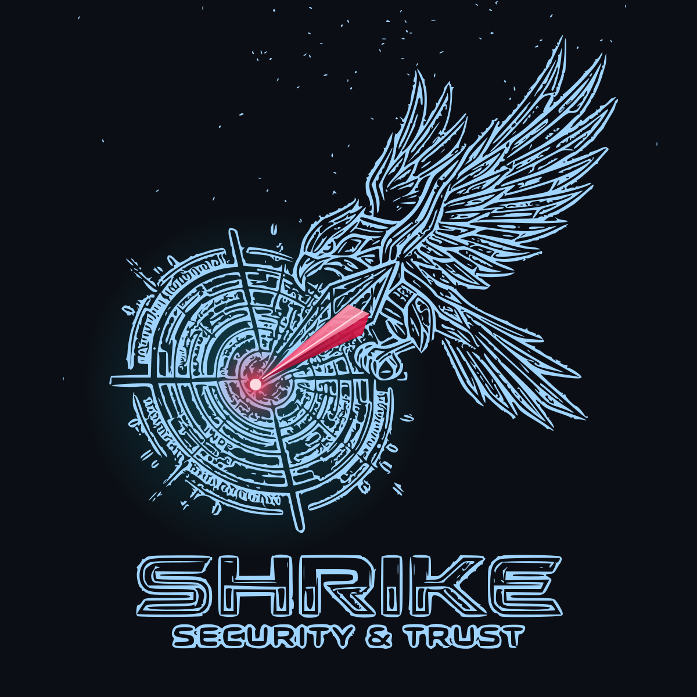
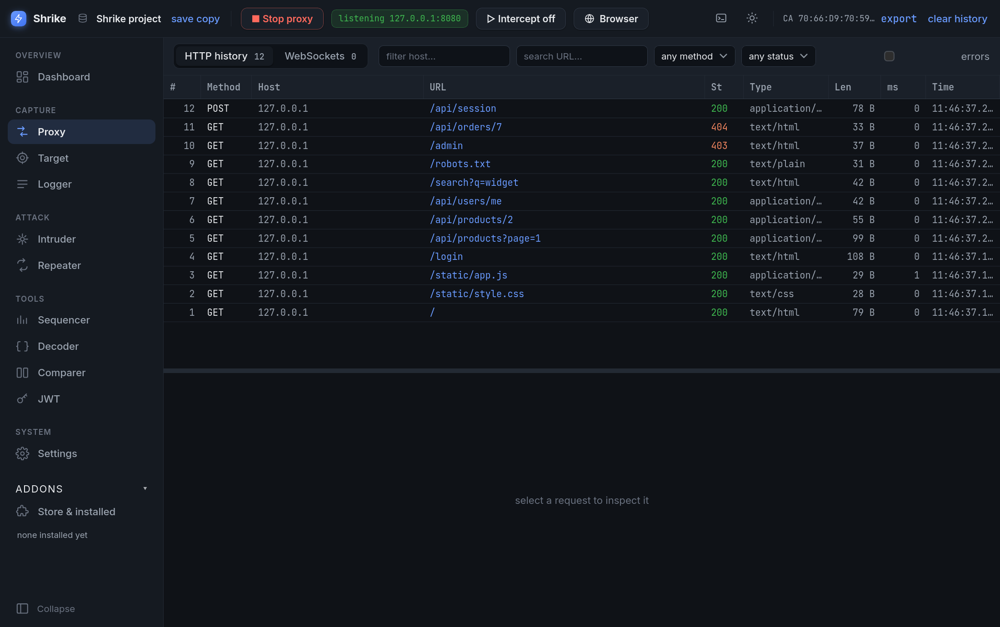
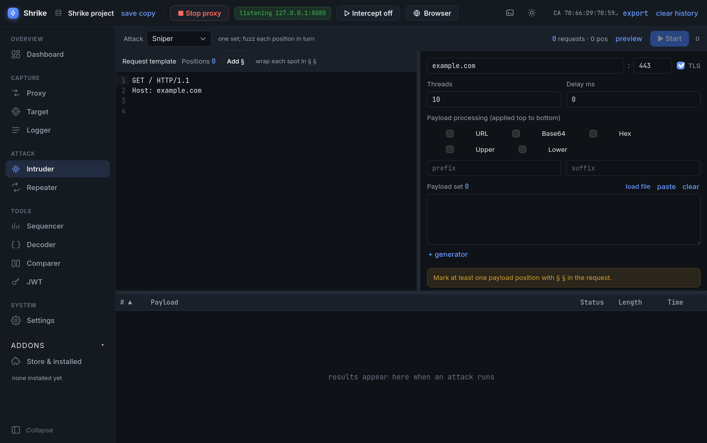
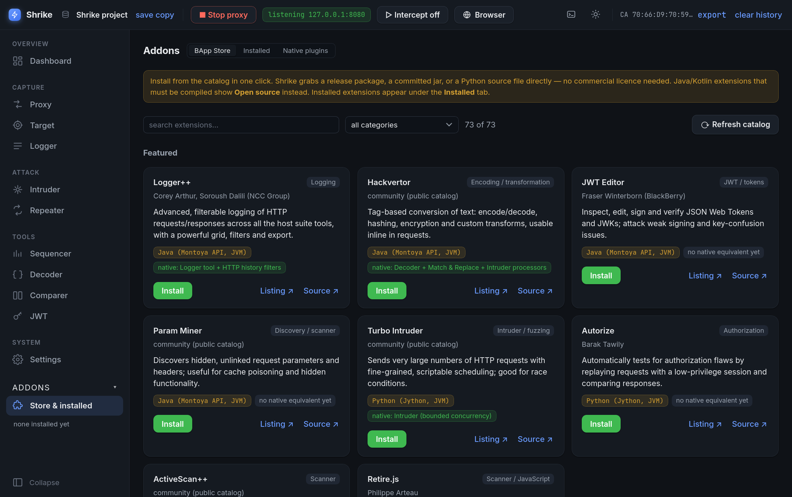
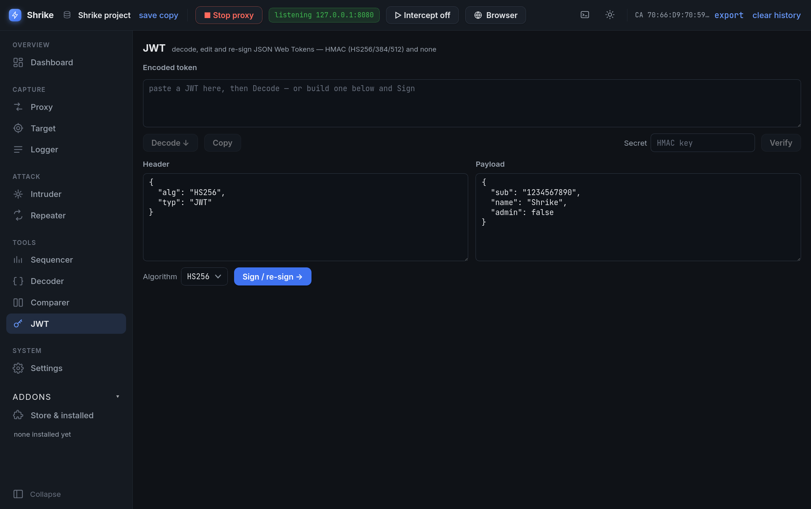

<p align="center">
  
</p>

<h1 align="center">Shrike</h1>

<p align="center">
  A clean-room <b>web security testing suite in Rust</b>: intercepting HTTPS proxy, Repeater, Intruder,
  Decoder, Comparer, Sequencer, JWT tools, a bundled Chromium, project files, and an addon system that
  runs BApps (Java and Python) alongside native plugins. A full professional-grade suite, rebuilt from scratch
  and open source.
</p>

<p align="center">
  <a href="https://github.com/ZeroDay-Labz/Shrike/releases/latest"></a>
  <a href="https://github.com/ZeroDay-Labz/Shrike/actions/workflows/ci.yml"></a>
  <a href="https://github.com/ZeroDay-Labz/Shrike/releases"></a>
  <a href="LICENSE"></a>
</p>

<p align="center">
  
</p>

Shrike is developed by [ZeroDay-Labz](https://github.com/ZeroDay-Labz) and licensed under MIT.
Nothing in it is derived from any proprietary tool's source or binary: it is modelled only on the
published Montoya / Extender extension APIs, public documentation, observable behaviour and open-source
analogues. See [docs/architecture.md](docs/architecture.md) and [docs/feature-gap.md](docs/feature-gap.md).

## Download

Releases are on the [Releases](https://github.com/ZeroDay-Labz/Shrike/releases) page:

| Platform | File | Install |
| --- | --- | --- |
| Windows 10/11 (x64) | `Shrike_<version>_x64-setup.exe` | Run it. SmartScreen may warn because the installer is not code-signed; choose *More info ▸ Run anyway*. |
| Fedora / RHEL / openSUSE | `Shrike-<version>-1.x86_64.rpm` | `sudo dnf install ./Shrike-<version>-1.x86_64.rpm` |
| Any Linux (AppImage) | `Shrike_<version>_amd64.AppImage` | `chmod +x` it and run. |
| Any Linux (portable) | `shrike-<version>-linux-x86_64.tar.gz` | Extract and run `./shrike-gui` (the headless proxy is `./shrike`). |
| Any Linux (Flatpak) | `shrike.flatpak` | `flatpak install --user shrike.flatpak` (needs the Flathub remote for the runtime) |

Java BApps need a JRE: Shrike uses a bundled one when the package ships it, otherwise any `java` on
your `PATH`. The **Addons ▸ Store & installed** tab sets up the host and Jython with one click.

## What it does

* **Proxy** — a real HTTPS MITM with its own CA, per-host leaf certificates, HTTP/1.1 + HTTP/2 and
  WebSockets. Passive request-focused history, scope rules enforced in the core, match & replace, and
  **Intercept** with forward / drop / forward-all.
* **Integrated browser** — a bundled Chromium (or your system one) launched pre-configured for the
  proxy and already trusting Shrike's CA. No FoxyProxy, no manual certificate import.
* **Target** — site map, and pick a host as the engagement scope.
* **Repeater** — tabbed manual requests with a scrollable editor and response viewer.
* **Intruder** — Sniper, Battering ram, Pitchfork and Cluster bomb with `§` payload positions, payload
  generators and processors, a bounded concurrent engine (hundreds of threads without locking the UI)
  and a virtualised results grid.
* **Decoder · Comparer · Sequencer · Logger · Dashboard** — the usual toolkit, native.
* **JWT** — decode, edit and re-sign tokens (HS256/384/512, `none`), in-app, no JVM.
* **Addons** — a BApp Store that mirrors the full public catalog from GitHub (featured first) and installs
  with one click from a release package, a committed jar **or straight from source** (Python entry
  points anywhere in the repo), then runs the extension in Shrike's own JVM host: Java via the
  published Montoya API, Python via Jython and the legacy Extender API. Each running addon gets its
  own entry in the side panel with a live console. Plus a native plugin API for Rust-side extensions.
* **Projects** — everything persists in an on-disk SQLite project (backup / save-a-copy, UI state),
  and XML item exports from other tools import straight into history.

## Screenshots

| Proxy history | Intruder attack |
| --- | --- |
|  |  |

| Addons side panel | JWT tool |
| --- | --- |
|  |  |

Screenshots are taken against local lab targets only — no real hosts, cookies or tokens.

## Build from source

The project is a Cargo workspace: `engine/` (library), `cli/` (headless proxy `shrike`),
`src-tauri/` (desktop app) and `ui/` (React + TypeScript frontend). You need Rust (stable),
Node 22, and on Linux the WebKitGTK dev packages (`libwebkit2gtk-4.1-dev librsvg2-dev
libappindicator3-dev patchelf`).

```sh
npm --prefix ui install      # first time only
npm run dev                  # launch the desktop app with hot reload
npm run build                # build installers (.rpm / AppImage / .exe) for this platform
scripts/package-tarball.sh   # portable Linux tarball after a release build
```

`cargo run` does not launch the GUI (Tauri wires the frontend through its own CLI); use
`npm run dev`. The headless proxy needs nothing extra:

```sh
cargo cli                    # or: cargo run -p shrike  — listens on 127.0.0.1:8080
cargo cli -- ca trust        # import the CA into local Firefox/Chrome profiles
cargo cli -- -l 0.0.0.0:8080 -k
```

Optional bundles for a self-contained package: `scripts/fetch-jvm.sh` (JVM host jars + a jlink
runtime) and `scripts/fetch-chromium.sh` (Chrome for Testing). Tests: `cargo test --workspace`.

## Trusting the CA (external browsers)

The integrated browser already trusts Shrike's CA. For any other client, export it
(`cargo cli -- ca export ~/shrike-ca.crt`, or browse to `http://shrike/cert` through the proxy) and
import it as a root; compare the SHA-256 fingerprint from `ca info` on import.

| Client | Steps |
| --- | --- |
| Firefox | Open `http://shrike/cert` through the proxy and tick *Trust this CA to identify websites*, or `ca trust` then restart. |
| Chrome / Chromium | `certutil -d sql:$HOME/.pki/nssdb -A -t "C,," -n shrike -i shrike-ca.crt` |
| Fedora system store | `sudo cp shrike-ca.crt /etc/pki/ca-trust/source/anchors/ && sudo update-ca-trust` |
| Debian / Ubuntu | `sudo cp shrike-ca.crt /usr/local/share/ca-certificates/shrike.crt && sudo update-ca-certificates` |
| Windows | `certutil -addstore -f Root shrike-ca.crt` |
| curl | `curl --proxy http://127.0.0.1:8080 --cacert shrike-ca.crt https://example.com/` |

## Roadmap

Shrike is built milestone by milestone toward full Pro parity — scanner (passive + active checks),
an out-of-band interaction service, the native plugin API around suite tabs / editor tabs / context
menus / engine hooks, and native ports of the most valuable extensions. Status and gaps are tracked
in [docs/feature-gap.md](docs/feature-gap.md).

## License

MIT — see [LICENSE](LICENSE). Use it only against systems you are authorised to test.
